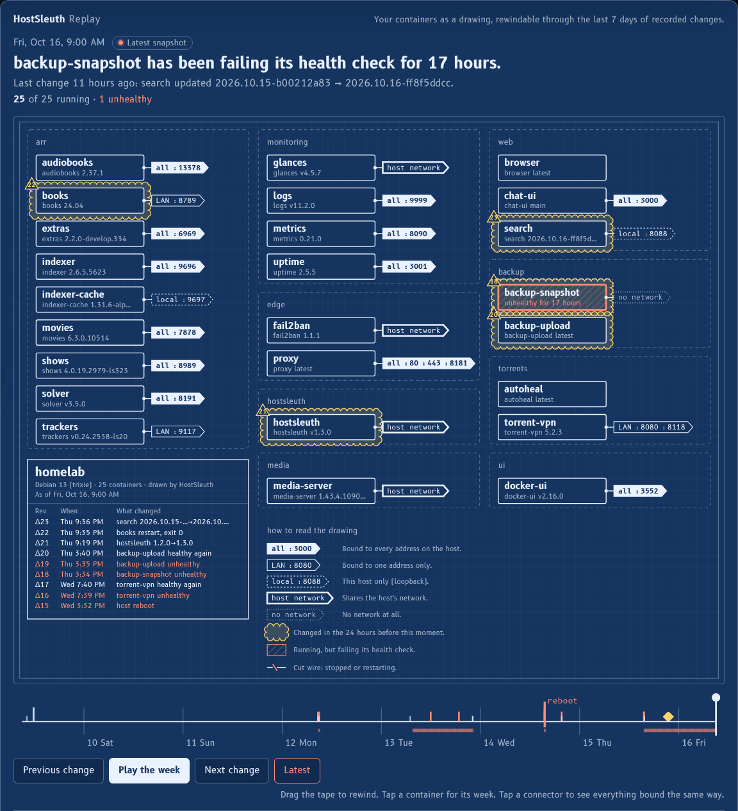
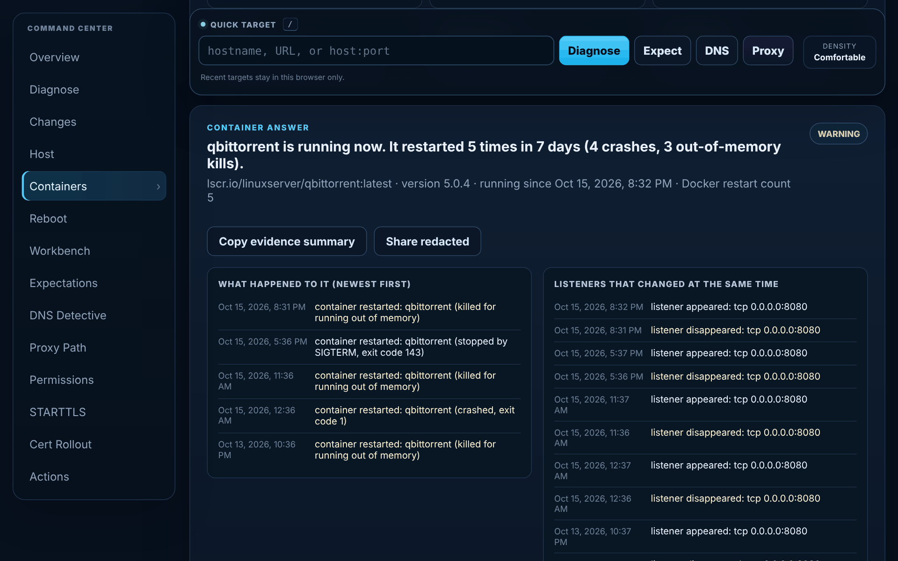
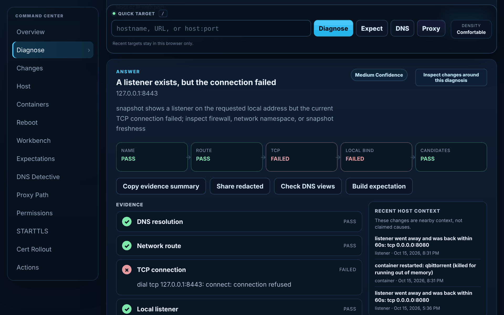
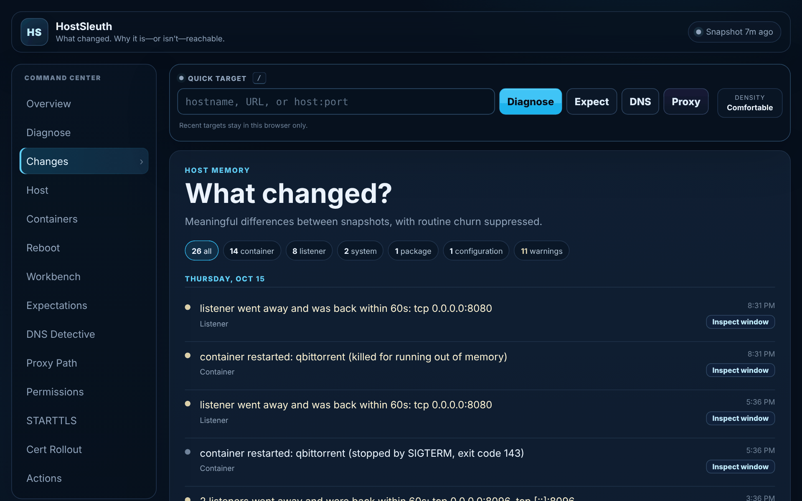
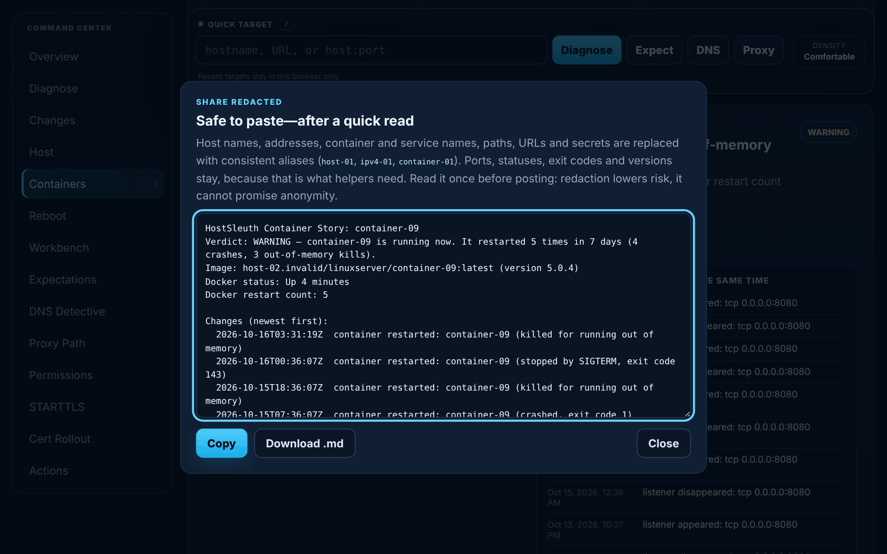
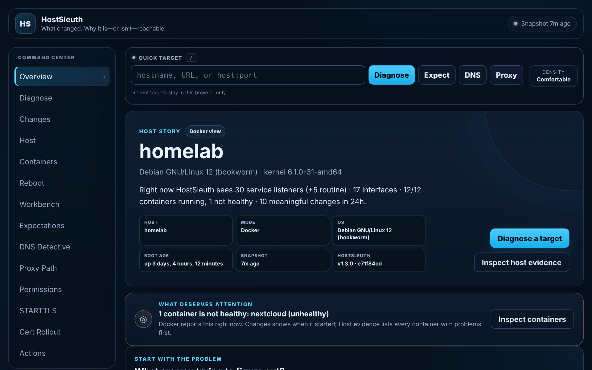

# HostSleuth

**Know what changed. Understand why it broke.**

HostSleuth is a small, local-first troubleshooting console for a Linux host and its Docker containers. It remembers meaningful changes and answers "why can't I reach this?" by checking DNS, route, port, listener, container, proxy and certificate in order—then telling you the first place reality stopped matching expectations.

One binary or one container. No cloud account, no database, no agent fleet, no AI. When evidence is missing it says *unknown* instead of guessing.



The home screen is **Replay**: your containers drawn as a blueprint, grouped by compose project, with what each one exposes (every address, one address, this host only, the host's network, no network). Drag the tape at the bottom and the drawing rewinds through the last seven days—containers go dashed when they were down, hatched when failing their health check, clouded when they changed—while one plain sentence says what was happening at that moment. Press **Play the week** to watch it.

**Release:** [latest stable](https://github.com/xXDasGoGXx/HostSleuth/releases/latest) · native Linux and Docker (`mjmalleo/hostsleuth`) for amd64 and arm64.

## What it answers

| You ask | HostSleuth shows |
| --- | --- |
| **What happened to this box this week?** | Replay: rewind the drawing to any moment. *"All 8 containers with a health check restarted at the same moment. That pattern fits a Docker restart."* |
| **Why can't I reach `nas:8443`?** | DNS → route → TCP → local listener → Docker publication → TLS, with the first failure called out: *"Docker publishes the port but TCP still failed: nextcloud (unhealthy)"*. |
| **Why does this container keep restarting?** | Every restart with Docker's own reason—crash and exit code, out-of-memory kill, clean stop—plus health changes and which of its ports went down with it. |
| **Did that update break it?** | Image updates as they happen: *"jellyfin updated 10.10.2 → 10.10.3"*, next to what changed right after. Works for `:latest` too. |
| **What changed on this box?** | A timeline of meaningful changes only: reboots, kernel and package updates, config fingerprints, services, containers, listeners. Interface churn and per-veth noise are left out. |
| **What failed to come back after the reboot?** | Reboot Story compares before and after; services that just picked a new random port (NFS/RPC) are not reported as missing. |
| **The proxy returns 502—where?** | Proxy Path walks the public URL and the upstream separately and shows where they diverge. |
| **Is DNS lying to me?** | DNS Detective compares the system resolver with resolvers you choose and flags split-view answers. |
| **Which server still has the old certificate?** | Cert Rollout checks up to 16 endpoints against the expected fingerprint. |
| **Can I ask for help without doxxing my network?** | **Share redacted** on every result: host names, addresses, container names, paths and secrets become consistent aliases; ports, statuses and exit codes stay. |

<table>
<tr>
<td width="50%"><br><sub><b>Containers</b> — restarts with Docker's reason, and the ports that went with them.</sub></td>
<td width="50%"><br><sub><b>Diagnose</b> — the ordered evidence chain and nearby changes, as context rather than blame.</sub></td>
</tr>
<tr>
<td width="50%"><br><sub><b>Changes</b> — reboots, updates, restarts and health, without socket noise.</sub></td>
<td width="50%"><br><sub><b>Share redacted</b> — paste-ready for a forum or an issue.</sub></td>
</tr>
<tr>
<td width="50%"><br><sub><b>Overview</b> — host story, what deserves attention, and quick targets.</sub></td>
<td width="50%"></td>
</tr>
</table>

## Quick start

**Docker** (most self-hosters). The supported Compose file gives HostSleuth the Docker socket, which it uses only for queries (`ps`, `inspect`, `events`), and binds the console to loopback:

```bash
git clone https://github.com/xXDasGoGXx/HostSleuth.git
cd HostSleuth
docker compose up -d
```

**Native Linux** (fullest view: systemd services, journals, packages, file permissions). The installer verifies the release binary against `SHA256SUMS`:

```bash
git clone https://github.com/xXDasGoGXx/HostSleuth.git
cd HostSleuth
sudo ./scripts/install.sh
```

Then open `http://127.0.0.1:8787`. On a remote server, tunnel it: `ssh -L 8787:127.0.0.1:8787 user@your-server`.

The first snapshot is the baseline, so the change timeline starts empty and fills as things change. LAN access, pinned versions, building from source and uninstalling are in [docs/INSTALL.md](docs/INSTALL.md).

## Safe by design

- **Read-only by default.** It does not restart, repair, update, reconfigure or reboot anything. Native mode offers two opt-in, per-service allowlisted actions (`service.restart`, `service.reload`) with preview, exact confirmation and audit; Docker mode offers none.
- **Local.** Nothing leaves the machine. No telemetry, no cloud, no accounts.
- **Careful with secrets.** Container details come from a field-limited `docker inspect` that never reads environment variables or mounts; private keys and config file contents are never read.
- **Honest.** Timing is shown as context, never as proof of cause.

Details: [SECURITY.md](SECURITY.md).

## Learn more

- [What each story does](docs/FEATURES.md)
- [Command line](docs/CLI.md)
- [Installing, LAN access, upgrades](docs/INSTALL.md)
- [Operations and recovery](docs/OPERATIONS.md)
- [Project records and roadmap](docs/PROJECT.md) — for contributors

## License

MIT. See [LICENSE](LICENSE).
